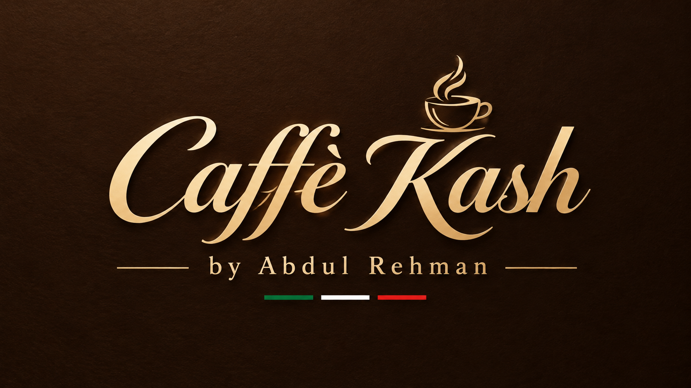

<div align="center">

<!-- Replace with your logo path once ready -->


# ☕ Caffè di Kash

**Italian coffee culture, crafted for the web.**

A responsive, multi-page café website with an espresso-brown and gold identity, built with HTML5, CSS3 and JavaScript.


[Live Demo](#) · [Report a Bug](#) · [Request a Feature](#)

</div>

---

## 📑 Table of Contents

- [About the Project](#-about-the-project)
- [Features](#-features)
- [Pages](#-pages)
- [Tech Stack](#-tech-stack)
- [Design System](#-design-system)
- [Project Structure](#-project-structure)
- [Getting Started](#-getting-started)
- [Responsive Design](#-responsive-design)
- [Learning Objectives](#-learning-objectives)
- [AI Usage Log](#-ai-usage-log)
- [Project Information](#-project-information)
- [Academic Integrity](#-academic-integrity)

---

## 📖 About the Project

**Caffè di Kash** is a modern, elegant, Italian-inspired coffee shop website that showcases specialty coffee, freshly baked pastries, and the welcoming atmosphere of a neighborhood café.

It was built as the **Web Technologies course project** to practise HTML5, CSS3, JavaScript, responsive web design, and Git/GitHub version control while delivering one cohesive website.

## ✨ Features

| | Feature |
|---|---|
| 🎨 | Elegant café branding and typography |
| 📱 | Responsive navigation and page layouts |
| ☕ | Coffee and pastry menu presentation |
| 👤 | Dedicated café story and founder section |
| 🕐 | Opening hours and visitor information |
| 🖼️ | High-quality café and product imagery |
| 🧩 | Reusable buttons, cards, and visual components |
| ⚡ | JavaScript-powered interactive elements |

## 📄 Pages

| Page | Description |
|---|---|
| **Home** | Introduces the café and highlights its identity |
| **Menu** | Showcases coffee, drinks, and pastries |
| **Our Story** | Shares the café's values and inspiration |
| **Visit** | Displays opening hours and directions |
| **Media & Information** | Course-required media, lists, and table |
| **Register / Contact** | Course-required form and input validation |
| **Services** | Presents café offerings using card layouts |
| **Portfolio** | Displays a gallery of project imagery |

> [!NOTE]
> Update this list to match the pages actually implemented in your final project.

## 🛠️ Tech Stack

| Technology | Used for |
|---|---|
| **HTML5** | Semantic page structure |
| **CSS3** | Styling, layouts, animations, and responsiveness |
| **JavaScript** | Interactive behavior and DOM manipulation |
| **Google Fonts** | Bodoni Moda, Jost, and Pinyon Script |
| **Git** | Version control |
| **GitHub** | Repository hosting and commit history |

## 🎨 Design System

Inspired by Italian café culture: warm, premium, and inviting.

| Element | Style |
|---|---|
| **Primary background** |  Espresso brown `#1D0E07` |
| **Accent** | Warm gold |
| **Headings** | Bodoni Moda (elegant serif) |
| **Body text** | Jost (clean sans-serif) |
| **Script accents** | Pinyon Script |
| **Layout** | Image-led sections and glass-style cards |

## 📁 Project Structure

```text
web-project/
├── index.html
├── menu.html
├── story.html
├── visit.html
├── feedback.html
├── contact.html
├── styles.css
├── script.js
└── README.md
```

> [!NOTE]
> This is an illustrative structure. Replace it with the actual HTML, CSS, JavaScript, and image filenames from your repository.

## 🚀 Getting Started

No build process is required. It's plain HTML, CSS, and JavaScript.

```bash
# 1. Clone the repository
git clone <your-repository-url>

# 2. Open the project folder
cd web-project
```

**3. Run the website:** open `index.html` in your browser, or use the **Live Server** extension in Visual Studio Code.

## 📱 Responsive Design

The site adapts to different screen sizes using CSS media queries and flexible layout techniques (Flexbox and Grid).

| Device | Tested |
|---|:---:|
| 🖥️ Desktop | ☐ |
| 📱 Tablet | ☐ |
| 📱 Mobile | ☐ |

## 🧠 Learning Objectives

- Semantic HTML and accessible page structure
- CSS selectors, typography, and the box model
- Flexbox and CSS Grid
- Transitions, transforms, and keyframe animations
- Responsive design and media queries
- HTML forms and validation attributes
- JavaScript fundamentals and DOM manipulation
- Git commits and GitHub collaboration workflows

## 🤖 AI Usage Log

AI tools were used as learning and development aids. Record your actual usage below, including the changes you made and what you learned.

| Tool | Purpose | My Changes / Learning |
|---|---|---|
| ChatGPT | HTML formatting and code explanations | Reviewed the formatted code and practised explaining its structure |
| ChatGPT | Café image and design ideas | Selected suitable visual concepts for the website |
| ChatGPT | Debugging assistance, if applicable | Document the specific fix and how you verified it |

> [!IMPORTANT]
> **Declaration:** I am responsible for understanding, reviewing, and explaining the code submitted in this project. I will document AI assistance accurately and ensure I can explain and recreate my work independently.

## 📌 Project Information

| | |
|---|---|
| **Project** | Web Technologies, Project 1 |
| **Website** | Caffè di Kash |
| **Developer** | Abdul Rehman |
| **Technologies** | HTML, CSS, JavaScript |
| **Repository** | [Add your GitHub repository link] |
| **Teacher Approval** | [Add the approval record link or reference] |

## 📚 Academic Integrity

This is an individual learning project. Code, design decisions, and AI assistance must follow the course requirements. The student should understand and be able to explain the implementation during the project demonstration and viva.

---

## 🏷️ Tags

`html5` `css3` `javascript` `responsive-design` `coffee-shop` `cafe-website` `italian-coffee` `restaurant-website` `multi-page-website` `frontend` `web-development` `student-project` `web-technologies` `flexbox` `css-grid` `dom-manipulation` `form-validation` `git` `github`

<div align="center">

**Caffè di Kash**
Italian-style coffee and pastries, made to order.

Made with ☕ by [Abdul Rehman](#)

</div>
